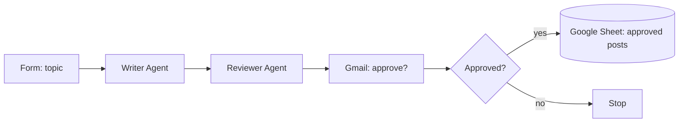

# LinkedIn Post Approval Workflow (n8n)

> Two AI agents write and review a LinkedIn post; nothing is saved until you approve it by email.

  

## Overview

A **human-in-the-loop** content pipeline. You submit a topic through an n8n form. A *Writer Agent* drafts the post, a *Reviewer Agent* improves it, and Gmail's *send and wait for approval* emails you the draft. Only approved posts are appended to a Google Sheet, ready to publish.

## Features

- Form trigger to submit a topic
- **Writer → Reviewer** agent chain (`gpt-4.1-mini`) with memory
- Approval by email with Gmail **send and wait**
- Approved posts logged to Google Sheets

## How it works



## Tech stack

| Layer | Technology |
|---|---|
| Automation | n8n |
| Agents | n8n LangChain Agents + OpenAI `gpt-4.1-mini` |
| Approval | Gmail send-and-wait |
| Storage | Google Sheets |

## Project structure

```text
.
├── LinkedIn Post Approval Workflow Using n8n.json   # n8n workflow export
└── LinkedIn Approved Posts.xlsx                     # sample output sheet
```

## Getting started

**Prerequisites:** a running [n8n](https://n8n.io) instance (n8n Cloud or self-hosted)

1. Download `LinkedIn Post Approval Workflow Using n8n.json` from this repository.
2. In n8n, open **Workflows → Import from File** and choose the JSON file.
3. Open each node that needs an account and connect your own credentials (listed below). The export contains no secrets, only credential names.
4. Click **Execute workflow** to test, then **Activate** it.

## Usage

Open the workflow's form URL, enter a topic, then approve or reject the draft in the email you receive.

## Notes

- Credentials to connect: OpenAI, Gmail, Google Sheets.
- Import `LinkedIn Approved Posts.xlsx` into Google Sheets and point the *Save Approved Post* node at it.

## License

Released under the [MIT License](LICENSE).

## Author

**Prasanth Sundararajan**, Senior SRE and AI Engineer  
[LinkedIn](https://www.linkedin.com/in/prasanth-s-a093a7109/) · [GitHub](https://github.com/prasanth-sundararajan)
